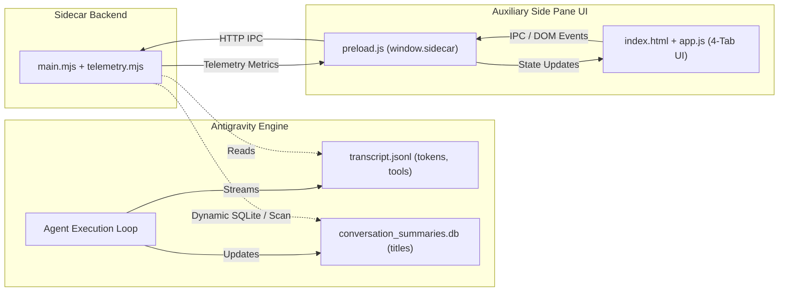

# Antigravity Observability Companion

[](https://github.com/iamnottheone99/antigravity-observability/actions)
[](LICENSE)
[](#)
[](#)
[-10b981.svg)](#)

A real-time, in-IDE observability dashboard, prompt cache analyzer, and human-in-the-loop steering extension for **Google Antigravity**.

Rendered directly inside Antigravity's **Auxiliary Side Pane**, this extension tracks financial costs, cache efficiency, tool distribution, and execution traces across all your agent sessions without adding latency to model generation loops.

---

## Features

* **Automated Agent Efficiency & Health Scorecard**:
  - Live 0–100 composite session evaluation score evaluating agent execution cleanliness and stability.
  - 4 weighted core pillars: **Tool Reliability** (30%, with error recovery bonus), **Loop Radar** (25%, penalizing consecutive and semantic loops), **Phase Balance** (25%, detecting unverified modifications or exploratory churn), and **Context Economy** (20%, tracking compaction frequency and headroom load).
  - Diagnostic grade badges: `Optimal` (emerald $\ge 90$), `Healthy` (blue 75–89), `Attention` (amber 60–74), and `Degraded` (rose $< 60$).
  - Expandable pillar breakdown with live micro-bars and actionable diagnostic deductions.
* **Error Taxonomy & Root-Cause Clustering**:
  - Automated zero-dependency classification of tool exceptions and execution failures into 8 standardized root causes: **File / Path Not Found**, **Edit Target Mismatch**, **Command Execution Failure**, **MCP Protocol Error**, **Tool Schema Error**, **Permission Denied**, **Timeout / Aborted**, and **General Runtime**.
  - Overview distribution bar with color-coded segments and total error count.
  - Interactive drill-down: clicking any error cluster pill in Overview jumps directly to Traces filtered strictly to that specific error root cause.
  - Dedicated sub-filter chips container in the Traces tab for rapid one-click root-cause filtering.
* **Cognitive Phase Classification & Spectrum**:
  - Classifies agent lifecycle actions into 5 distinct cognitive phases: **Exploration** (code search, file reads), **Synthesis** (planning, reasoning, prompt analysis), **Execution** (file modifications, code authoring), **Verification** (running tests, linters, git diffs), and **Recovery** (debugging errors, fixing failures).
  - Dedicated **Cognitive Phase Spectrum** in the Overview tab with percentage distribution bar, engine badge, and interactive hover breakdowns.
  - Per-step cognitive phase badges (`[EXPLORATION]`, `[EXECUTION]`, `[VERIFICATION]`, `[RECOVERY]`, `[SYNTHESIS]`) rendered in the Waterfall Activity Timeline.
  - Traces filter search natively matches cognitive phases (e.g., searching "recovery" or "verification").
* **Semantic Loop & Stall Radar**:
  - Detects semantic action loops beyond exact signature matches (e.g. repeated file slicing, command variations, test retry loops) by computing vector and n-gram similarity across execution windows.
  - Leverages local `zvec-grep` neural embeddings (`local/potion-code-16m-v2`) when present, with a high-speed zero-dependency statistical n-gram fallback.
  - Flags loops in the real-time Alert Banner with exact similarity metrics (e.g., "Repetitive exploration loop detected (88% similarity across 3 steps)").
* **Prompt Cache Analytics**:
  - Detailed prompt cache savings ($0.1125 / 1M tokens saved) and token breakdown in session reports.
  - Mathematically bounded Prompt Cache Hit Rate calculation ($\frac{\text{cached}}{\text{uncached} + \text{cached}} \times 100\%$).
  - Per-step breakdown of fresh prompt tokens, cached prompt hits, and completion tokens in trace drawers.
* **Antigravity Context Window & Headroom Meter**:
  - Live tracking of active context window volume against the 1.0M Gemini token limit.
  - Visual load percentage bar with amber warning ($\ge 70\%$) and red danger ($\ge 85\%$) thresholds.
  - Automatic detection and tracking of Antigravity context compaction events (`<CONTEXT_SUMMARY>`).
* **Active Model & Ecosystem Telemetry**:
  - Real-time model detection badge in the side pane header (e.g. `Gemini 3.8 Flash (High)`, `Gemini 1.5 Pro`).
  - Granular MCP server breakdown tracking invocations across individual servers (e.g. Engram, zvec-grep, Chrome DevTools).
  - Multi-agent delegation metrics tracking subagents spawned and messages dispatched.
  - Active Skills detection mapping `SKILL.md` ingestions and skill CLI executions.
  - Artifact tracking tallying generated plans, walkthroughs, and workspace deliverables.
* **Agent Velocity & Tool Health**:
  - Step turnaround latency meter computing average step duration (`Avg 2.1s/step`).
  - Tool reliability percentage tracking successful tool executions versus errors (`98.5% ok`).
* **Vertical Waterfall Trace Timeline & Deep Inspector**:
  - Full-height continuous execution rail with duration tags (`+1.2s`) and status indicators.
  - Expandable detail drawers showing structured tool arguments, exact command lines, and target files.
  - Live execution output previews displaying terminal stdout, stderr, and tool result snippets with one-click copy.
  - Model reasoning & strategy preview exposing agent thinking (`step.thinking`) prior to tool calls.
  - Per-step token economics tracking input tokens, cache hits, output tokens, and dollar cost per step.
  - Real-time search bar to filter traces by tool, file, command, or text, alongside domain filter chips (`All`, `Tools`, `Errors`) and `Expand All` controls.
* **Human-in-the-Loop Steering**:
  - Quick action chips: `Pause & Explain`, `Run Tests`, and `Review Diffs`.
  - Inline prompt injector to steer the agent directly from the side panel.
  - One-click **Copy Markdown Report** for sharing session traces in PRs or issues.
* **Categorical Tool Spectrum & Skills Tagging**:
  - Segmented distribution bar grouping calls into File Edits, Shell/Terminal, Search/Read, Subagents, and per-server MCP segments.
  - Active Skills tag row displaying live skill and MCP activations (e.g., `graphify`, `archify`, `engram`, `zvec-grep`).
* **Seamless Multi-Chat Auto Tracking**:
  - Automatically queries Antigravity's `conversation_summaries.db` with graceful fallback to brain directory scans across all Node.js 20+ runtimes.
  - **Auto** mode dynamically follows whichever conversation was modified most recently.
* **In-UI Monitoring Toggle & Manual Refresh**:
  - One-click `[ ON / OFF ]` button to pause and resume live polling without closing or unmounting the extension.
  - Dedicated **Refresh** button in the top bar to trigger immediate, uncached reload of transcripts and session states.

---

## Architecture


*An interactive version with path tracing, dark/light themes, and export controls is available at [docs/architecture.html](docs/architecture.html).*



---

## Quick Start

### Prerequisites
* **Node.js 20+** installed
* **Google Antigravity** (IDE or Antigravity 2.0 desktop app)

### 1. Clone & Install
```bash
# Clone the repository
git clone https://github.com/iamnottheone99/antigravity-observability.git
cd antigravity-observability

# Install the plugin into your global Antigravity plugins directory
npm run install-plugin
```

> The install script copies the plugin bundle to:
> - **Windows**: `%USERPROFILE%\.gemini\config\plugins\agent-observability\`
> - **macOS / Linux**: `~/.gemini/config/plugins/agent-observability/`

### 2. Enable in Antigravity
1. Open Google Antigravity.
2. In the left sidebar, click the **Customizations** icon.
3. Under the **Installed** tab, find **`agent-observability`** and toggle it **ON**.
4. Open any chat, click **⋮** (top right) $\rightarrow$ **Extensions** $\rightarrow$ **Observability**.

---

## Repository Layout

```text
antigravity-observability/
├── .github/
│   └── workflows/ci.yml     # Multi-OS CI matrix (Node 20, 22, 24)
├── docs/
│   └── API.md               # Sidecar HTTP API & telemetry schema documentation
├── package.json             # Root scripts (test, install-plugin) and metadata
├── scripts/
│   ├── install.mjs          # Cross-platform installer with error handling
│   └── test.mjs             # Unit tests & manifest validation test suite
├── CHANGELOG.md             # Version release history
├── CONTRIBUTING.md          # Contribution guidelines
└── plugin/                  # The Antigravity plugin bundle
    ├── plugin.json          # Plugin manifest
    ├── assets/
    │   └── logo.svg         # Telemetry radar icon
    └── sidecars/
        └── panel/
            ├── sidecar.json # Aux pane extension declaration
            ├── package.json # ES module package configuration
            ├── main.mjs     # Node.js backend (reads transcripts & SQLite summaries)
            ├── classifier.mjs# Cognitive phase & semantic loop embedding engine
            ├── telemetry.mjs# Pure analytics, cost calculation & loop radar
            ├── index.html   # 4-Tab client-side interface
            ├── styles.css   # Dark-mode theme-aware styling
            └── app.js       # Live polling & UI rendering logic
```

---

## Testing & Verification

Run the automated test suite to verify unit tests, calculations, and manifests:

```bash
npm test
```

---

## Documentation

* [API Reference](docs/API.md) — Sidecar HTTP routes, schema, and pricing formulas.
* [Contributing Guide](CONTRIBUTING.md) — Development setup and contribution workflow.
* [Changelog](CHANGELOG.md) — Version release notes.

---

## License

Distributed under the MIT License. See [`LICENSE`](LICENSE) for more details.
