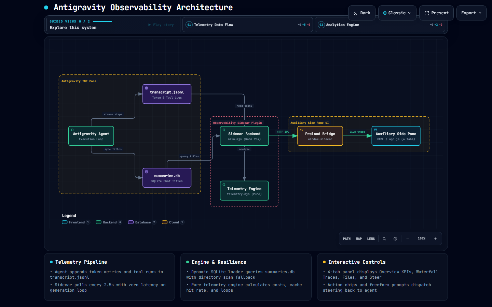
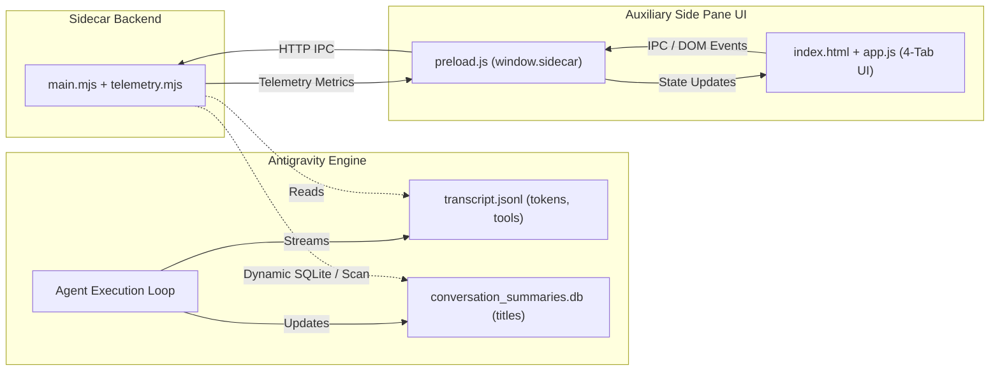

# Antigravity Observability Companion

[](https://github.com/iamnottheone99/antigravity-observability/actions)
[](LICENSE)
[](#)
[](#)
[-10b981.svg)](#)

A real-time, in-IDE observability dashboard, prompt cache analyzer, and human-in-the-loop steering extension for **Google Antigravity**.

Rendered directly inside Antigravity's **Auxiliary Side Pane**, this extension tracks financial costs, cache efficiency, tool distribution, and execution traces across all your agent sessions without adding latency to model generation loops.

---

## Features

* **Live Cost & Cache Hit Analytics**:
  - Calculates real-time dollar cost with discounted prompt caching.
  - Mathematically bounded Prompt Cache Hit Rate gauge ($\frac{\text{cached}}{\text{uncached} + \text{cached}} \times 100\%$).
  - Breakdown of fresh prompt tokens, cached prompt hits, and completion tokens.
* **Vertical Waterfall Trace Timeline & Deep Inspector**:
  - Full-height continuous execution rail with duration tags (`+1.2s`) and status indicators.
  - Expandable detail drawers showing structured tool arguments, exact command lines, and target files.
  - Live execution output previews displaying terminal stdout, stderr, and tool result snippets with one-click copy.
  - Model reasoning & strategy preview exposing agent thinking (`step.thinking`) prior to tool calls.
  - Per-step token economics tracking input tokens, cache hits, output tokens, and dollar cost per step.
  - Real-time search bar to filter traces by tool, file, command, or text, alongside domain filter chips (`All`, `Tools`, `Errors`) and `Expand All` controls.
* **Human-in-the-Loop Steering**:
  - Quick action chips: `Pause & Explain`, `Run Tests`, and `Review Diffs`.
  - Inline prompt injector to steer the agent directly from the side panel.
  - One-click **Copy Markdown Report** for sharing session traces in PRs or issues.
* **Loop & Stall Radar**:
  - Sliding-window signature detector that flags repetitive tool calls ($\ge 3$ consecutive executions with identical arguments).
* **Categorical Tool Spectrum**:
  - Segmented distribution bar grouping calls into File Edits, Shell/Terminal, Search/Read, and Subagents.
* **Seamless Multi-Chat Auto Tracking**:
  - Automatically queries Antigravity's `conversation_summaries.db` with graceful fallback to brain directory scans across all Node.js 20+ runtimes.
  - **Auto** mode dynamically follows whichever conversation was modified most recently.
* **In-UI Monitoring Toggle**:
  - One-click `[ ON / OFF ]` button to pause and resume live polling without closing or unmounting the extension.

---

## Architecture



*An interactive version with path tracing, dark/light themes, and export controls is available at [docs/architecture.html](docs/architecture.html).*



---

## Quick Start

### Prerequisites
* **Node.js 20+** installed
* **Google Antigravity** (IDE or Antigravity 2.0 desktop app)

### 1. Clone & Install
```bash
# Clone the repository
git clone https://github.com/iamnottheone99/antigravity-observability.git
cd antigravity-observability

# Install the plugin into your global Antigravity plugins directory
npm run install-plugin
```

> The install script copies the plugin bundle to:
> - **Windows**: `%USERPROFILE%\.gemini\config\plugins\agent-observability\`
> - **macOS / Linux**: `~/.gemini/config/plugins/agent-observability/`

### 2. Enable in Antigravity
1. Open Google Antigravity.
2. In the left sidebar, click the **Customizations** icon.
3. Under the **Installed** tab, find **`agent-observability`** and toggle it **ON**.
4. Open any chat, click **⋮** (top right) $\rightarrow$ **Extensions** $\rightarrow$ **Observability**.

---

## Repository Layout

```text
antigravity-observability/
├── .github/
│   └── workflows/ci.yml     # Multi-OS CI matrix (Node 20, 22, 24)
├── docs/
│   └── API.md               # Sidecar HTTP API & telemetry schema documentation
├── package.json             # Root scripts (test, install-plugin) and metadata
├── scripts/
│   ├── install.mjs          # Cross-platform installer with error handling
│   └── test.mjs             # Unit tests & manifest validation test suite
├── CHANGELOG.md             # Version release history
├── CONTRIBUTING.md          # Contribution guidelines
└── plugin/                  # The Antigravity plugin bundle
    ├── plugin.json          # Plugin manifest
    ├── assets/
    │   └── logo.svg         # Telemetry radar icon
    └── sidecars/
        └── panel/
            ├── sidecar.json # Aux pane extension declaration
            ├── package.json # ES module package configuration
            ├── main.mjs     # Node.js backend (reads transcripts & SQLite summaries)
            ├── telemetry.mjs# Pure analytics, cost calculation & loop radar
            ├── index.html   # 4-Tab client-side interface
            ├── styles.css   # Dark-mode theme-aware styling
            └── app.js       # Live polling & UI rendering logic
```

---

## Testing & Verification

Run the automated test suite to verify unit tests, calculations, and manifests:

```bash
npm test
```

---

## Documentation

* [API Reference](docs/API.md) — Sidecar HTTP routes, schema, and pricing formulas.
* [Contributing Guide](CONTRIBUTING.md) — Development setup and contribution workflow.
* [Changelog](CHANGELOG.md) — Version release notes.

---

## License

Distributed under the MIT License. See [`LICENSE`](LICENSE) for more details.
